# Yu-Peng Wang

B.S. Civil Engineering, National Taiwan University (expected 2027) Cumulative GPA 3.94/4.30 · Major GPA 4.02/4.30 Undergraduate Researcher, Computer-Aided Engineering (CAE) Group

My research interests lie in AI for the built environment, particularly how LLM agents and knowledge graphs can make Building Information Modeling (BIM) data accessible through natural language.

Taipei, Taiwan · b11605031@ntu.edu.tw · [LinkedIn](https://www.linkedin.com/in/yu-peng-wang-490296424/)

---

## Research

### BIMantic: Natural Language Querying of IFC Models Using LLM-Generated Knowledge Graph
*Research Intern, Computer-Aided Engineering Group, NTU · Jul – Aug 2026* *Advisor: Prof. Shang-Hsien Hsieh · Mentor: Akarsth Kumar Singh*

- Rebuilt an IFC-to-Neo4j knowledge-graph pipeline using IfcOpenShell, with workflows that validate LLM-generated query specifications before execution
- Developed a web interface with a 3D viewer for BIM models
- Benchmarked five commercial and open-source LLMs on 100 questions for accuracy, latency, and API cost, using LLM-as-a-judge; the best model reached 75% accuracy at a 6.6 s median latency

  <a href="assets/bimantic_poster.jpg">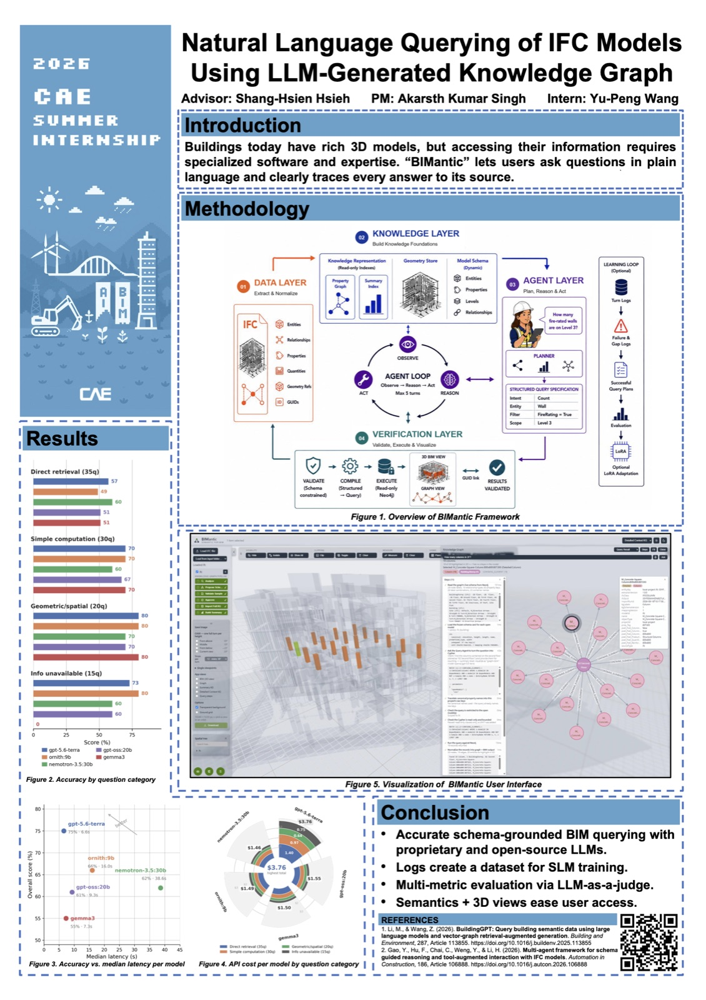</a> 
  Research poster, CAE Summer Internship 2026

  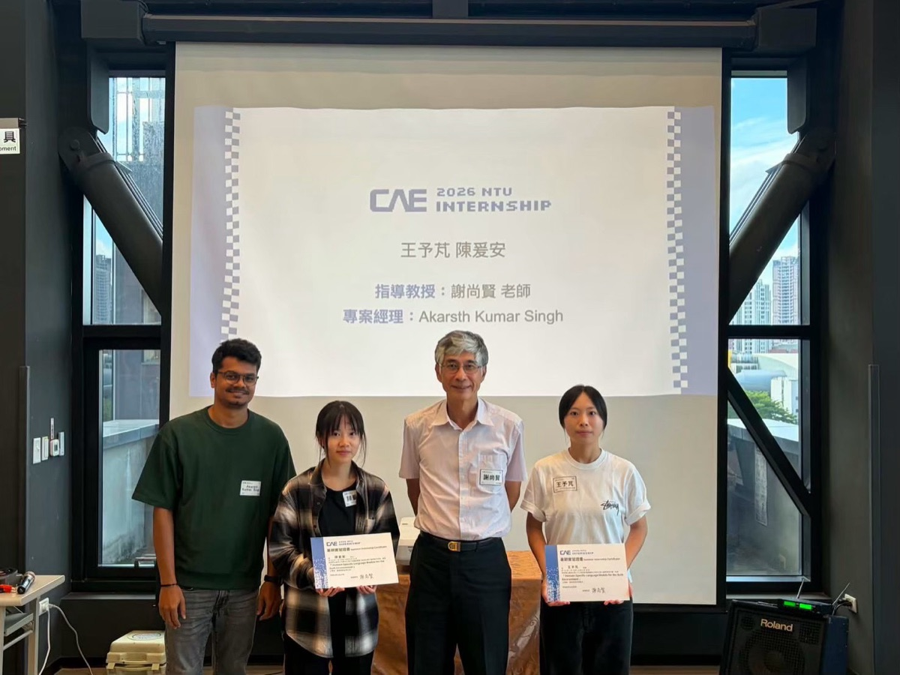 
  Receiving the internship certificate with Prof. Shang-Hsien Hsieh and mentor Akarsth Kumar Singh, CAE Summer Internship 2026

### Procedural Graphs for BIM Agents
*Undergraduate Researcher, Computer-Aided Engineering Group, NTU · Sep 2026 – Present* *Advisor: Prof. Shang-Hsien Hsieh · Mentor: Akarsth Kumar Singh*

- Co-design a procedural graph framework that helps BIM agents learn from successful and failed execution traces
- Investigate trace-based learning and fine-tuning with limited domain-specific training data

### EEG-Based Prediction of Golf-Putting Success
*Undergraduate Research Student, Master Program in Statistics, NTU · Feb 2026 – Present* *Advisor: Prof. Yan-Bin Chen*

- Engineered features from pre-putt electroencephalography (EEG) recordings and tuned an XGBoost classifier to predict putting success
- Across 14 comparative experiments, reduced the feature set from 570 to 57 using three midline channels while raising AUROC from 0.48 to 0.72 on the same test set

---

## Projects

### Fushou Bridge · Feb – Aug 2025
*Design–Build Team Member · Xitou Nature Education Area*

A 12-meter double-curvature cedar footbridge, now open to visitors.

- Developed the design and verified building-code compliance
- Fabricated glulam members from AutoCAD and SketchUp models and assembled the bridge on site

  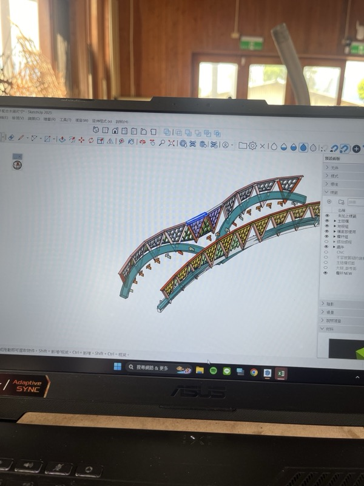
  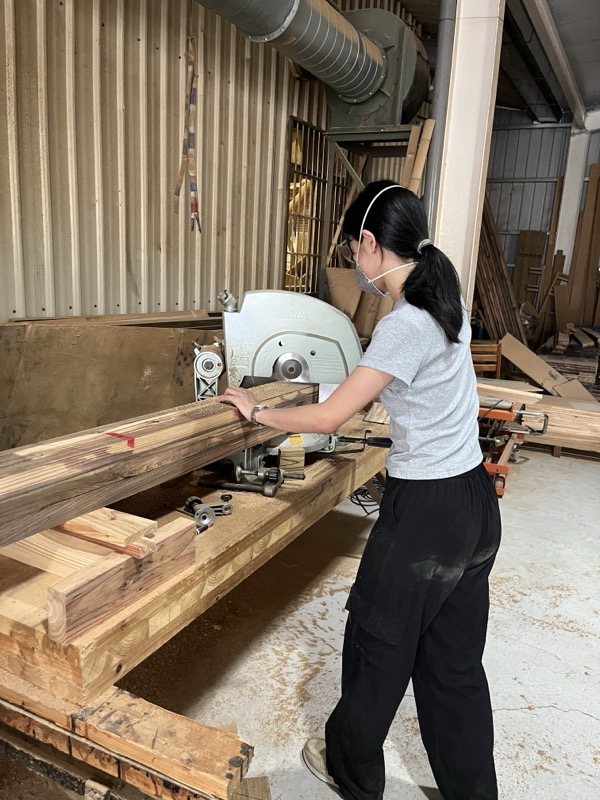
  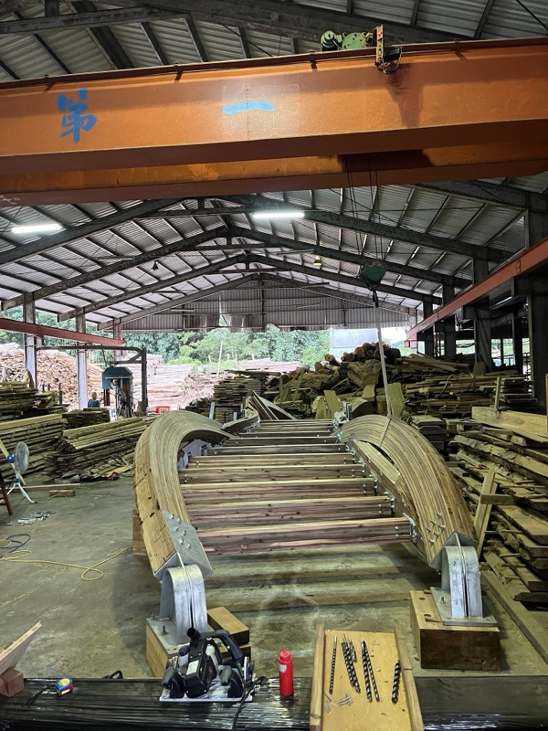

  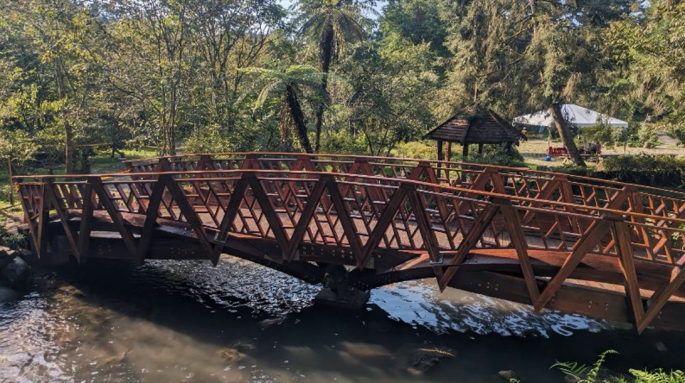 
  Design model, fabrication, workshop assembly, and the completed bridge

### Carousel: Floating Wind Turbine Tower · Dec 2024
*Conceptual Design Studio, NTU · Team of four* *Best Structural Design, Student's Choice, and TA's Choice*

Designed, built, and tested a scale-model floating wind turbine tower with a rotating base and a mooring system.

- Designed a timber truss tower with a mid-height damper to reduce sway, a bearing that lets the whole tower rotate with the wind, and an octagonal bowl-shaped base that breaks incoming waves
- Compared two mooring designs and selected a chain-and-pulley system that is less sensitive to water depth and returns the tower to position more reliably
- Ran tension, buoyancy, wave, wind, and offset tests; fixed a screw-joint failure found in tension testing, and the tower returned to position within 4.75 s after a 35 cm offset

  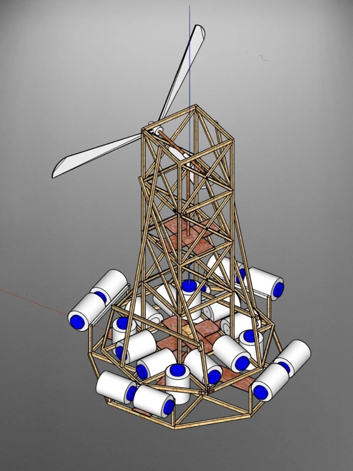
  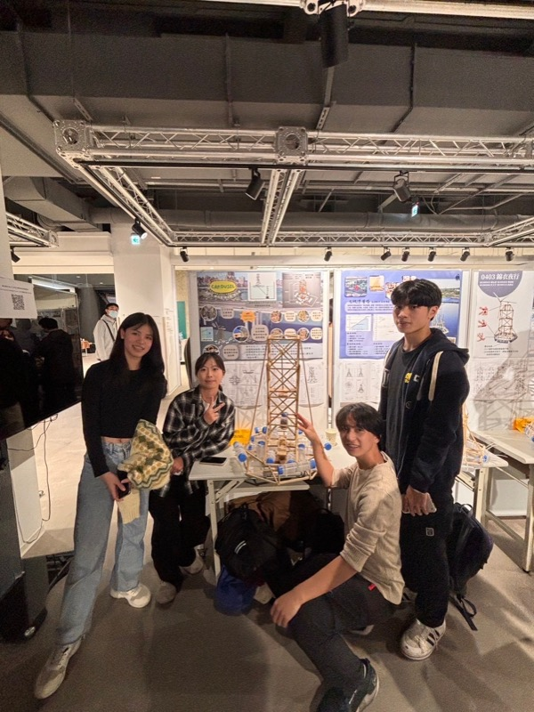

### 3D Ball Track · Spring 2024
*Physical Model Design Laboratory, NTU · Team of four* *Most Thrilling Track Award*

Designed and built a 3D steel-wire track that sends a steel ball through a series of stunts. Selected by professors and TAs from nearly 30 teams at the final exhibition.

- Designed and built the team's entire track, including three gaps the ball must jump
- A funnel catches the ball after the first gap and reverses its direction. The ball then clears the second gap and runs a full vertical loop
- After the third gap, a waterwheel catches the ball, turns 90 degrees under its weight, and releases it onto the next track
- Four linked vertical S-curves carry the ball to a glockenspiel we built, where it plays notes as it bounces across the keys

https://github.com/user-attachments/assets/5503aea3-83fe-43b2-941f-e31bc9d183b4

  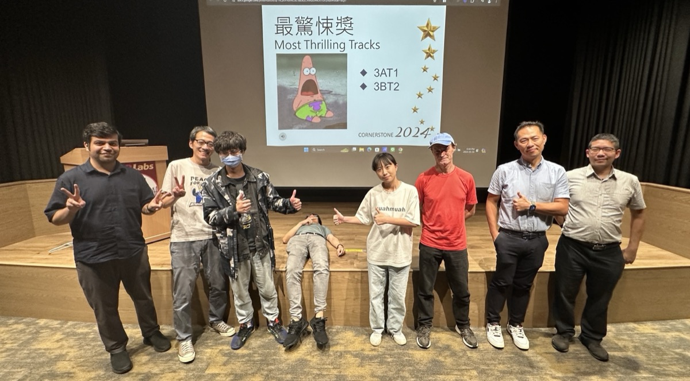 
  Most Thrilling Track Award, with the course professors and TAs

### Ranking Geological Factors for Landslide Susceptibility with Machine Learning · Jun 2025
*First Author · Soil Mechanics course project, team of five*

Ranked five geological factors by their influence on landslide susceptibility in Taiwan and interpreted the results through geotechnical theory.

- Built a dataset of 1,050 samples from government open data on slope, elevation, rainfall, aspect, and lithology
- Trained ten Random Forest models on different feature combinations and merged their rankings with a weighted score. Slope and lithology, especially shale and conglomerate, ranked highest, consistent with prior studies
- Used soil mechanics to explain where our ranking differed from the literature: rainfall ranked low because a static three-day total cannot capture delayed pore-pressure buildup, and missing interaction terms hid the effects of aspect and elevation

  <a href="assets/landslide_poster.jpg">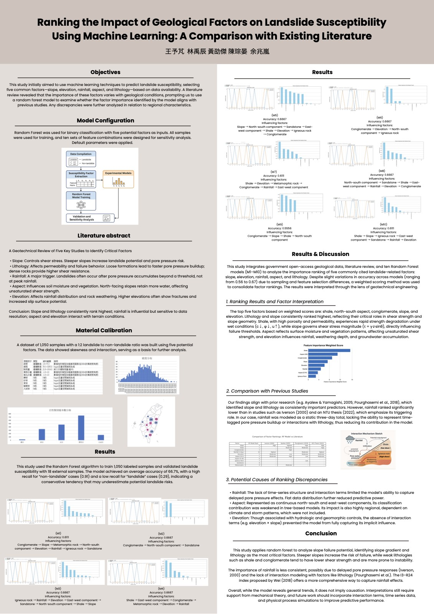</a>

### Seismic Building-Damage Prediction · Nov 2026
*Kaggle competition · Introduction to Machine Learning and Deep Learning, NTU*

Predicted the earthquake damage grade of buildings (three levels) from structural and site attributes.

- Found that only about 25 of 238 features carried signal, and corrected for different class ratios between training and test data
- Combined six models (LightGBM, CatBoost, a neural network, and GLMs) in a stacking ensemble, reaching a cross-validated balanced accuracy of 0.686

**Code:** [yupengwang-dev/seismic-damage-prediction](https://github.com/yupengwang-dev/seismic-damage-prediction)

### Real-Time Traffic-Sign Recognition · Jul – Aug 2025
*Smart Mobility Competition, China Engineering Consultants, Inc. · Team of five · 5th Place*

Built a model self-driving car that reads traffic signs in real time.

- Photographed a wide range of traffic signs to build our own training dataset, then wrote the code to train a CNN classifier
- Ran the model on a Raspberry Pi with an onboard camera and tested the car on a scaled road course

  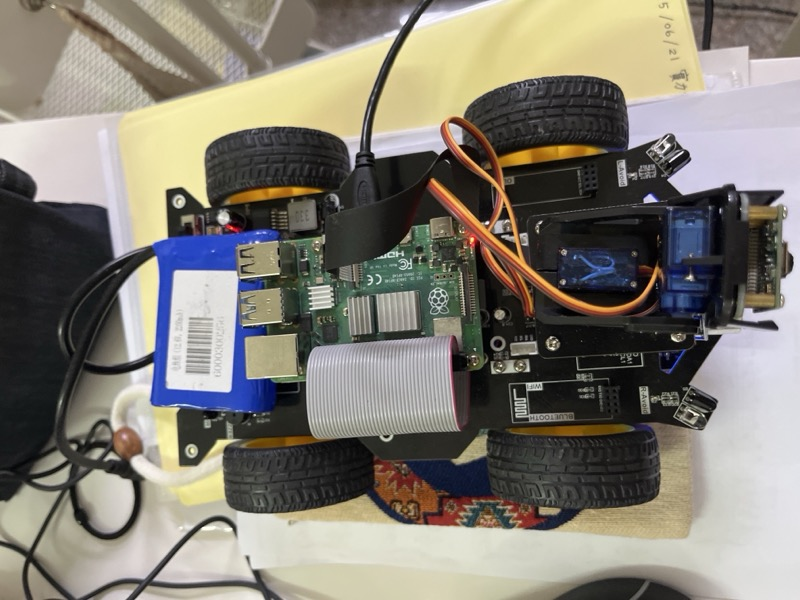
  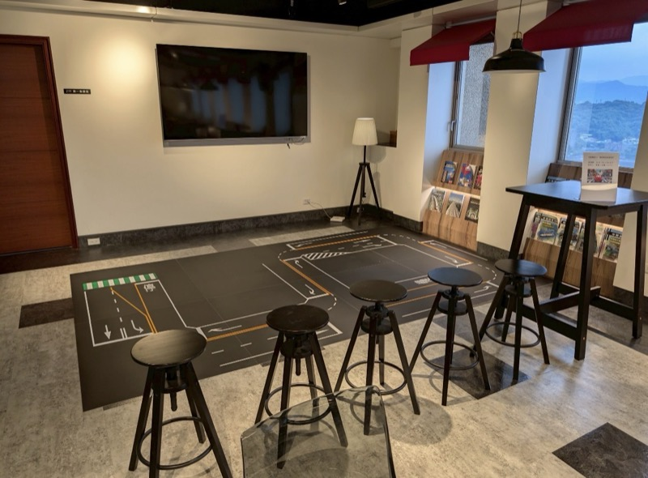

### beyon · Oct 2025 – Present
*Founder & Lead Developer*

An iOS app, set in a 3D digital twin of Taiwan, that gives people a new way to tell someone they like them.

- Designed and built the product end to end: product design, geospatial data pipeline, a SwiftUI iOS app embedding a Unity 3D world, and a Supabase backend (PostgreSQL/PostGIS, Auth, Realtime)
- Built a 3D model of all of Taiwan from OpenStreetMap and government geospatial data: about 6.9 million building footprints extruded to measured heights, about 800 individually modeled landmarks, and an island-wide ground-level road network
- Reconstructed 537,000 hand-digitized roads into continuous alignments of tangents and circular arcs, similar to horizontal curve design, with automated quality checks on every island-wide rebuild
- Admitted to the NTU Garage Startup Incubation Program (2026 cohort)

  
   
  Left: Taipei's Xinyi District in beyon's 3D world. Right: when two people who like each other meet, the stars they left for each other merge into one.

---

## Honors and Awards

| Year | Award |
|---|---|
| 2026 | NTU Garage Startup Incubation Program, 2026 Cohort — one of 20 teams selected from about 100 applicants |
| 2025 | 5th Place, Smart Mobility Competition, China Engineering Consultants, Inc. |
| 2024 | Best Structural Design, Student's Choice, and TA's Choice — Conceptual Design Studio final exhibition, NTU |
| 2024 | Most Thrilling Track Award — Physical Model Design Laboratory final exhibition, NTU |
| 2023 | Academic Excellence Award, Department of Forestry, NTU — ranked first in the department (GPA 4.30/4.30) |

---

## Technical Skills

| Area | Tools |
|---|---|
| Programming and Machine Learning | Python, PyTorch, scikit-learn, XGBoost, LightGBM, CatBoost |
| BIM and CAD | Revit, AutoCAD, SketchUp, IFC, IfcOpenShell |
| LLMs and Knowledge Graphs | LLM agents, Neo4j, Cypher |
| GIS and App Development | GIS data processing, PostgreSQL/PostGIS, Unity, SwiftUI, Supabase |
| Surveying and Hardware | Total station, level, Raspberry Pi, NVIDIA DGX Spark |
| Spoken Languages | Mandarin Chinese (native), English |

---

## Leadership

- **President, NTU Women's Football Club** · Sep 2025 – Jun 2026 
  Rebuilt a club facing disbandment by recruiting members and organizing training and inter-university matches, bringing it back to the NTU club fair for the first time in nearly 20 years.
- **Volunteer Teacher, International Companions for Learning, NTU** · Sep 2025 – Jan 2026 
  Partnered with an exchange student to teach weekly online English and culture lessons to rural elementary school students.
